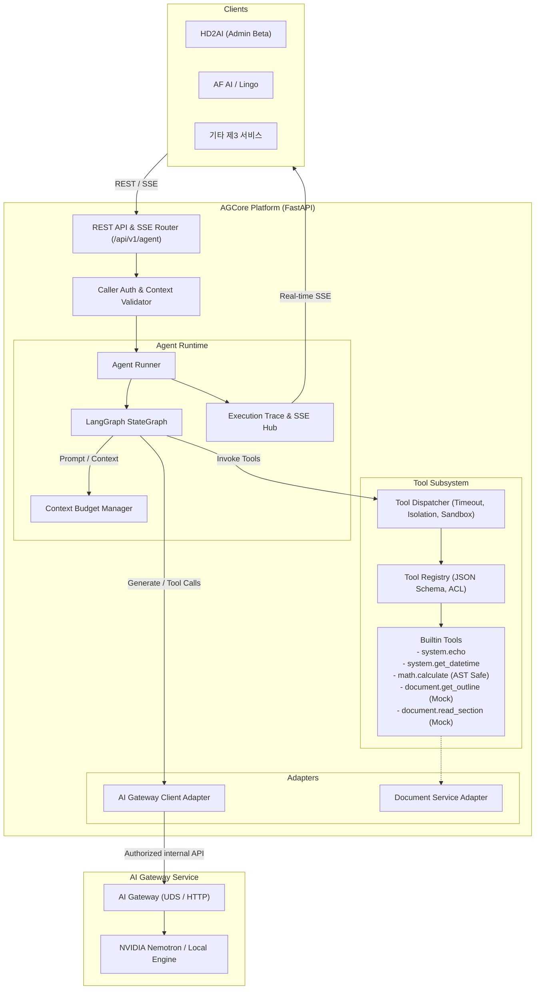
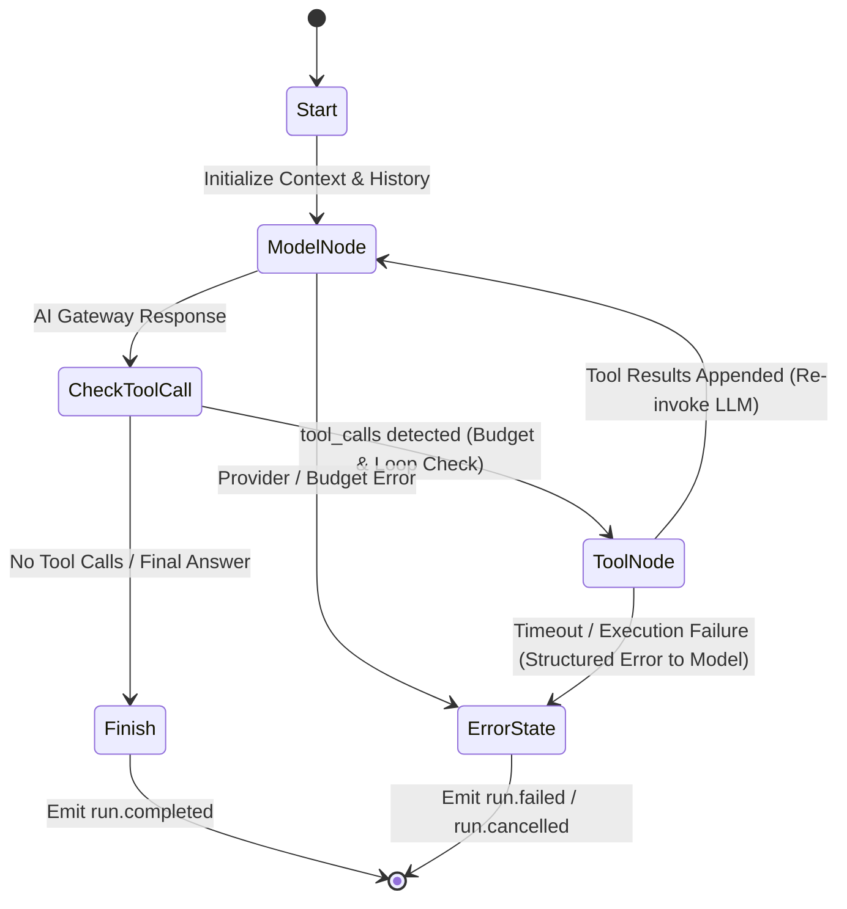

# AGCore 아키텍처 및 런타임 설계 (ARCHITECTURE)

## 1. 개요
AGCore(HD2Lab Agent Core Platform)는 독립 실행형 범용 Agent Runtime 플랫폼입니다. FastAPI 웹 프레임워크와 LangGraph 라이브러리를 기반으로 구축되며, AI Gateway를 통해 LLM 추론을 수행하고, 내장된 Tool Registry & Dispatcher를 통해 도구를 자율적으로 실행합니다.

## 2. 시스템 아키텍처 다이어그램

## 3. LangGraph StateGraph 실행 루프

### 3.1 상태 정의 (`AgentState`)
- `messages`: 대화 및 도구 실행 메시지 목록 (role: system, user, assistant, tool)
- `step_count`: 현재 실행 단계 카운트 (최대 10)
- `tool_call_count`: 누적 도구 호출 횟수 (최대 6)
- `context_budget`: 잔여 토큰 예산 및 제어 상태
- `traces`: 실시간 실행 트레이스 이벤트 기록
- `status`: 현재 상태 (`queued`, `running`, `completed`, `failed`, `cancelled`)
- `error`: 실패 시 오류 코드 및 메시지

### 3.2 핵심 노드 구성
1. **Model Node (`model_node`)**:
   - 현재 대화 메시지와 등록된 Tool Definitions를 AI Gateway Adapter로 전달.
   - Gateway로부터 스트리밍 또는 단일 응답 수신.
   - 응답에 `tool_calls`가 포함되어 있으면 Tool Node로 분기, 일반 답변이면 Finish로 분기.
2. **Tool Node (`tool_node`)**:
   - `tool_calls` 목록을 검증.
   - 독립적인 읽기 도구는 `asyncio.gather`를 통해 병렬 실행.
   - 도구 실행 결과를 `tool` role 메시지로 변환하여 State에 추가.
   - 도구 실패 시 예외로 멈추지 않고, 모델이 인지할 수 있는 구조화된 에러 JSON(`{"error": true, "code": "...", "message": "..."}`)을 모델에 반환하여 모델이 복구/대체 답변을 시도하게 함.
3. **루프 종료 조건**:
   - LLM이 더 이상 도구를 호출하지 않고 최종 답변을 작성했을 때.
   - `max_agent_steps` (10회) 또는 `max_tool_calls` (6회) 초과 시.
   - 전체 실행 타임아웃 (`run_timeout_seconds`: 120초) 도달 시.
   - 클라이언트 취소 요청 시 (`run.cancelled`).

## 4. Context Budget Manager
- 토큰 예산 기본값: `12,000` 토큰
- 도구 단일 결과 상한: `2,000` 토큰 (초과 시 잘림 및 경고 첨부)
- 오래된 도구 결과 메시지는 요약 및 압축 수행
- 중복 호출 캐싱 (멱등성 있는 도구의 동일 인자 호출 시 캐시 응답)

## 5. Tool Registry & Dispatcher
- **보안 격리**:
  - `math.calculate`: `eval()` 절대 미사용. Python `ast` 기반의 화이트리스트 수식 파서 (숫자, 기본 사칙연산, 거듭제곱, 안전한 math 함수만 허용).
  - 임의 OS 명령이나 파일 시스템 접근 금지.
- **서비스별 ACL**:
  - 호출 서비스(예: `hd2ai-admin`, `af-ai`)별 도구 사용 허용 목록(Whitelist) 적용.
- **비동기 타임아웃 통제**:
  - 각 도구 실행별 타임아웃 (기본 30초) 적용.
